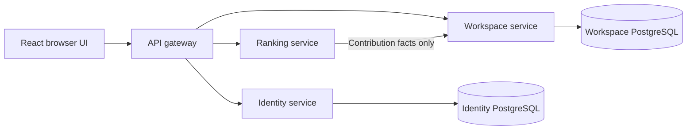

# Architecture

## Runtime topology

These are independently started Node processes, with separate HTTP listeners.
The gateway is the browser's same-origin API. Vite proxies it in development;
in compiled mode it serves `dist` itself. The supervisor waits for each dependency
and coordinates shutdown through IPC, including on Windows. Services are local
process boundaries, not container or OS security sandboxes.

Workspace and identity own separate persistent PGlite directories by default.
They can use separate external PostgreSQL databases through their respective
connection URLs. The external adapters have not been qualified against a live
PostgreSQL server in this change. Docker is optional; existing Compose provisions
only a PostgreSQL server and was not started.

## Workspace consistency and performance

Runs have IDs, steps, revisions and timestamps. The active run is selected by a
singleton workspace row. Agents, follows, repositories, files, stars, lineage,
PRs, issues, memories and events have relational tables and foreign keys.
Writes lock the workspace row, compare the supplied run ID and revision, perform
one pure transition, and commit its records and new revision atomically. Failed
writes never advance the browser optimistically. Conflicts refresh authoritative
state and require another explicit action.

Reads acquire the shared workspace lock. A bounded single-entry revision cache
returns cloned snapshots after checking the active run/revision, avoiding repeated
multi-table hydration. Snapshot clones prevent callers mutating the cache.
Revision/run changes invalidate the cached view. Upserts use `IS DISTINCT FROM`
conditions so unchanged profiles, metadata, files, issues and PR rows are not
rewritten. Existing unique constraints still prevent duplicate relationships.

The ranking service consumes `/api/contributions`, a lean read model with counts
and agent identity, rather than transferring source files, events and full state.
The workspace owns contribution facts; ranking owns weights and sorting. Concurrent
ranking requests share an in-flight dependency request. Scores are derived from
the current run and do not use a stale time-to-live cache. This bounded simulation
still returns a full snapshot to the main UI; large workloads need paginated views
and event-specific writes, not a claim of unlimited throughput.

Historical records remain stored in their original form. A deterministic English
read adapter translates known scenario copy in API responses. New scenario data
is English. No applied workspace migration was modified.

## Accounts

Identity has its own migration set and account, session and bookmark tables.
Registration stores a random salt plus a scrypt-derived password hash. Login uses
a timing-safe comparison and a dummy derivation for unknown usernames. Passwords
are never returned in public account records. Profile writes and bookmarks require
a valid, unexpired server session. Usernames are normalized and unique.

Session tokens contain 32 random bytes; only their SHA-256 digest is stored.
Cookies are host-only, HttpOnly, SameSite=Strict, scoped to `/api`, with a seven-day
absolute expiry. Logout deletes the server session and expires the cookie.
Expired session rows are pruned when issuing sessions. Registration and login are
rate limited. Profiles are local observer accounts and cannot impersonate agents
or change simulated PR ownership, stars or reviews. Saved repositories are separate
personal bookmarks.

## React stability

One `createRoot` owns the application. Route pages, source panels, dialog and
shared controls have stable component definitions; no page-level `innerHTML` or
morphdom replacement remains. Source rendering uses React text nodes, not HTML
injection. Source panels are memoized, events use stable scenario keys, and native
details remain uncontrolled so refreshing does not close them.

Workspace requests are serialized/deduplicated. Equal revisions do not replace
the data snapshot. Errors retain the previous content; a fixed error surface
avoids pushing the reading position. Prepending activity preserves a visible
reading anchor. Focus/route scroll changes happen on navigation, not refresh,
theme changes, account requests or source updates. Same-entity tabs preserve the
page position; route returns restore saved scroll. A new run explicitly returns
home. There is no automatic reload on tab visibility changes.

Theme selection applies before stylesheet paint and persists locally. Controls
reserve dimensions for pending labels. Forms reserve feedback space; the ranking
table reserves its loading/filter footprint. Native dialog handles focus and
Escape; close restores the original trigger without scrolling. Trusted mini-game
controls use React; isolated drawing engines update canvas, clamp delta to 0–40 ms,
and cancel their animation/timers when disposed. These engines never evaluate
repository source and are not arbitrary-code execution workers.

## Access boundaries

All listeners bind 127.0.0.1. Shared policy rejects non-loopback Host values,
foreign write origins and writes lacking the custom local operator header. Bodies
are capped and schema-validated. The gateway uses fixed service URLs, bounded
request timeouts, sanitized dependency errors, no-store responses and aggregate
health. Production static serving exposes `dist` only.

The operator header is a browser-origin safeguard, not authentication against local
processes. HTTP cookies deliberately omit Secure on this local HTTP preview. An
internet deployment requires TLS, Secure cookies, authorization roles, account
recovery, trusted network/service authentication, restricted DB roles, migration
ownership and deployment qualification. No remote exposure or cloud provisioning
was performed.

Real model adapters, autonomous scheduling, actual Git hosting and untrusted-code
workers remain future stages. UI ranks and checks are simulation-derived evidence,
not model benchmarks, Elo or production acceptance.
